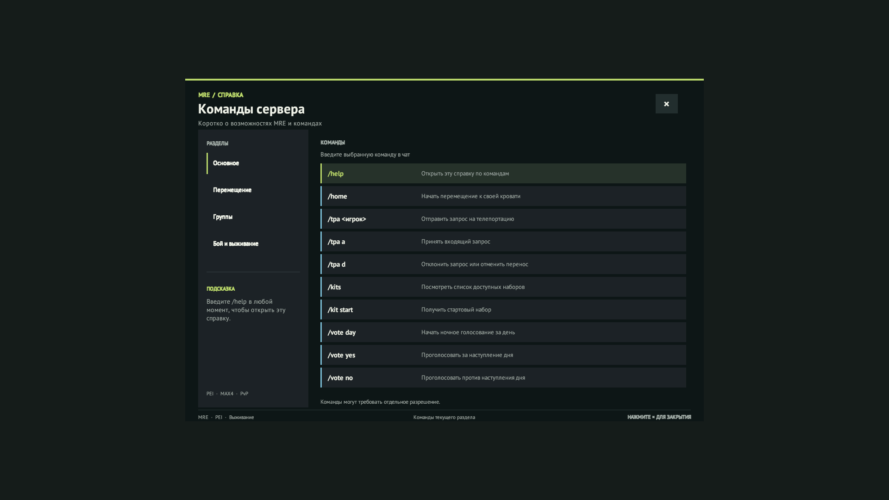

# Команда `/help` и окно справки

`/help` заменяет штатную Rocket-справку на список публичных команд MRE. Алиас `/mrehelp` ведёт к той же команде. Администраторские команды не перечисляются. Разделы справки показывают только зарегистрированные команды, на которые у игрока есть соответствующее право. Если MRE UI-эффект недоступен или занято модальное окно, команды выводятся в чат.

## Окно

Исходный Unity-проект находится в `ui/MreHelp`. Предпросмотр: [mre-help.png](../ui/preview/mre-help.png).



Сборка проекта Unity 2022.3.62f3:

```powershell
.\scripts\Build-MreHelpAssets.ps1
.\scripts\Build-MreHelp.ps1
.\scripts\Install-MreHelp.ps1 -Apply
```

Чтобы подготовить локальный пакет существующего Workshop-ресурса MRE HUD с новым эффектом:

```powershell
.\scripts\Build-MreHelpWorkshopPackage.ps1
```

Команда создаёт отдельный каталог в `runtime/workshop-packages`; она не изменяет загрузки Workshop, сервер или файлы клиента. Новый эффект имеет ID `48625`, GUID `6e4a31b4-9c87-4f42-8a62-2e1a68e4d203`, key `14825` и Windows bundle `MreHelp.unity3d`.

## Статус

Серверная DLL и Windows EffectAsset собираются локально. `/help` можно зарегистрировать с текстовым fallback. Для отображения окна подключённому клиенту нужен тот же asset bundle; сборка локального Workshop-пакета сама по себе его не распространяет. Workshop-пакет не опубликован, игровой показ и клики не подтверждены. Не загружайте новый пакет в Workshop, пока не проверите его на локальном клиенте и сервере.
