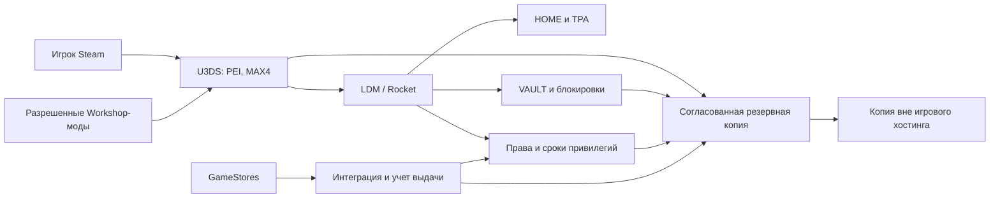

# MRE: план от идеи до первого стабильного сезона

Дата исследования: 28 октября 2026 года. Время мероприятий: Москва.

Обновление реализации 30.10.2026: локальный U3DS с PEI, базовыми плагинами и двумя разрешенными модами установлен; серверные проверки и восстановление пройдены. Текущие результаты и оставшиеся проверки — в [LOCAL_INSTALLATION.md](LOCAL_INSTALLATION.md). Остальной текст описывает полный план, включая еще не выполненные этапы.

## 1. Что строим

MRE — собственный сервер Unturned на стандартной PEI: PvP-выживание, группы до четырех игроков, HOME, TPA и VAULT. Основной образец выбран владельцем — **REDLINE #1**, а не #6 с экономикой и MAX6. Прием платежей планируется в России. Хостинга пока нет; бюджет не установлен.

Дешевый путь: один сервер, готовая игровая панель, LDM/Rocket, небольшой набор проверенных плагинов, оригинальные общедоступные моды, готовая витрина GameStores. Начальные 24 слота; увеличение до 32–48 только по результатам испытаний. Панель, собственный сайт, отдельный бот и несколько игровых миров одновременно не требуются.

Результат этой работы — проектная документация, смета, задачи и критерии приемки. Локальная бета уже установлена и проверена в объеме отчета LOCAL_INSTALLATION.md; хостинг не куплен, магазин не подключен. Завершение реализации означает стабильную работу в течение первого месяца, проверенную выдачу покупок и успешный первый вайп.

## 2. Что удалось установить о REDLINE

В публичной карточке #1 видны PEI, Easy, PvP, MAX4, HOME/TPA/VAULT, список Workshop и названия плагинов. Это дает образец функций, но не исходный код, настройки всех плагинов или внутреннюю статистику проекта. Публичный разбор находится в [REDLINE_AUDIT.md](REDLINE_AUDIT.md). Источник наблюдений: [карточка #1](https://www.restoremonarchy.com/servers/85568392924629545).

Среди ресурсов есть общедоступные More Farming и William's Vehicles, а также собственные RedLine-моды. Автор основного [RedLine-мода](https://steamcommunity.com/sharedfiles/filedetails/?id=1991009929) ограничивает его назначение своими проектами. В MRE используем разрешенные оригиналы и собственные решения. Видимый GameStores-магазин пока не раскрыл карточки товаров, поэтому точное совпадение цен и прав доната не подтверждено.

Заявление «1XLOOT» не является готовым параметром конфигурации. В аудите отдельно отмечены рекламное название, публичные поля и вычисления мониторинга. Для MRE фиксируем реальные настройки и проверяем игровой результат.

## 3. Три версии проекта

| Версия | Что входит | Для кого | Условие перехода |
|---|---|---|---|
| Локальный прототип | PEI, MAX4, вход, сохранение, HOME/TPA | Владелец и 2–4 тестера | Нет ошибок старта; работают права и рестарт |
| Закрытая бета | Проверенные моды, VAULT, combat/raid ограничения, полный backup/restore | 8–12 приглашенных тестеров | Пройдены проверки потерь вещей, дюпа и нагрузки |
| Публичная MRE 1.0 | Проверенные базовые функции, правила, модерация, рабочая витрина | Первые 12–24 игрока | Пройдены все блокирующие пункты приемки |

Если безопасного VAULT еще нет, можно продолжать тесты под названием «MRE beta без VAULT». Публичную версию с обещанным VAULT и продажу расширения хранилища открываем после его приемки. Аналогично платные игровые функции появляются в каталоге только после проверки.

## 4. Предварительные игровые правила MRE

Это стартовые решения для тестирования, а не подтвержденные настройки REDLINE.

| Параметр | Предложение MRE | Как проверить |
|---|---|---|
| Карта | Стандартная PEI | Чистый клиент входит без сторонней карты |
| Основа сложности | Easy как у образца; каждое значимое изменение записать | Проверить смерть, урон, лут, навыки и зомби |
| Группы | Максимум 4; союзные обходы запрещены правилами | Пятый не входит; обходы разбирает модератор |
| Лут | Без общего ускорения ×2; реальную плотность подобрать на Easy | Пройти один и тот же маршрут с новым персонажем |
| Перспектива | Первая и третья | Проверить PvP и прицеливание |
| HOME | Базово 1 дом на основе привязанной кровати; ожидание 15 секунд, перерыв 5 минут | Урон/движение/смерть отменяют перенос |
| TPA | Запрос и согласие; ожидание 15 секунд, перерыв 5 минут | Оба участника проходят проверки блокировок |
| PvP block | Исходно 60 секунд после урона игроку/от игрока | HOME/TPA/VAULT/платные команды не обходят бой |
| Raid block | Исходно 180 секунд; событие и радиус закрепить по возможностям плагина | Блок действует на атакующих и защищающихся по опубликованной модели |
| VAULT | Маленький базовый объем для всех; точный размер после выбора реализации | Предметы не теряются и не удваиваются |
| Рейды | Обычные рейды; ночную защиту и сложные расписания отложить | Урон базам измерен и понятен обеим сторонам |
| Базы и фермы | Мягкие лимиты по замерам нагрузки | Не вводить произвольные ограничения без предупреждения |
| Очистка неактивных баз | Начальный ориентир 7 дней; до публикации проверить реализацию | Активная база сохраняется, неактивная удаляется ожидаемо |
| Вайп мира | Раз в 28 дней, первый по объявленному расписанию | Репетиция на копии, уведомления и список сбросов |
| Права доната | 30 суток; срок идет по календарю | Работает истечение во время офлайна |

Ожидания телепорта, сроки блокировок и объемы VAULT могут потребовать настройки или небольшой разработки. До проверки конкретного плагина они остаются требованиями. Не публиковать цифры, которые выбранная сборка не умеет обеспечить.

Не добавляем на первом этапе глобальный денежный магазин, продажу взрывчатки, казино, рулетки, боевой пропуск, сложный HUD и сезонные собственные карты. У #1 другая основа игрового цикла; лишние механики увеличат стоимость настройки и нарушат баланс.

## 5. Техническая схема

Платежное подтверждение, выдача на сервере и срок привилегии — три разных состояния. Реализация может использовать готовые компоненты, но должна пройти общие сценарии повторной доставки, рестарта и восстановления. Свой платежный backend для этого автоматически не требуется.

Технические инструкции, источники, лицензии и запасные варианты — в [TECHNICAL_PLAN.md](TECHNICAL_PLAN.md). Важные отправные точки: [официальный запуск U3DS](https://docs.smartlydressedgames.com/en/stable/servers/server-hosting.html) и [LDM](https://github.com/SmartlyDressedGames/Legally-Distinct-Missile).

## 6. Деньги и способ экономии

Ориентир найденных базовых тарифов — примерно **650–1100 ₽ в месяц**. Самая низкая цифра не гарантирует свободного узла, DDoS-защиты, нужной производительности или доступа к плагинам. Подтвержденные характеристики и ограничения перечислены в [BUDGET_AND_SHOP.md](BUDGET_AND_SHOP.md).

Для планирования разумно иметь **3000–4500 ₽ на первые три месяца**, оплачивая аренду помесячно. Это резерв проекта, а не цена пакета у провайдера. Нижний вариант возможен при более дешевом подходящем тарифе и копиях на уже имеющийся компьютер. Комиссии с продаж, налоги и труд считаются отдельно; резерв не является прогнозом дохода.

| Статья | Минимальный вариант |
|---|---|
| Тестовый сервер | Имеющийся компьютер; дополнительные электричество/интернет отдельно |
| Публичный хостинг | Один игровой инстанс, 24 слота, ориентир 6–8 GB RAM для тестирования |
| Моды | Разрешенные оригиналы; покупка закрытой сборки не заложена |
| Плагины | Бесплатные с проверенной лицензией; недостающий функционал оценить до обещаний |
| Сайт и магазин | Поддомен GameStores, без собственного домена |
| Сообщество | VK как основная доступная площадка; Discord как дополнительная |
| Бэкапы | Отдельная копия на имеющийся компьютер либо условно до 200 ₽/мес после выбора хранилища |
| Реклама | 0 ₽ на начальной проверке спроса |
| Настройка и модерация | Время владельца; денежная стоимость внешней помощи отдельно |

[GameStores](https://gamestores.app/) публикует отсутствие ежемесячной платы и комиссию 7% успешных платежей. Это не доказательство полного размера всех издержек: отдельно выясняем эквайринг, вывод и налоги.

Бесплатная готовая сборка может сократить время только после проверки состава, лицензий и безопасности. Для минимального бюджета предпочтительнее короткий список понятных зависимостей. Не покупать год аренды до тестирования узла.

### Время владельца

Плановая оценка базовых задач — примерно **80–100 часов**, включая подготовку, испытания и первые эксплуатационные процедуры; начальный backlog содержит 92 часа оцененных задач. Окно 2–4 недели до открытия требует нескольких часов работы в день и пригодных готовых компонентов. Это инженерная оценка, не договорная цена. Недостающие функции считаются отдельно: сроки рангов или общий guard — ориентировочно 12–24 часа на каждый, ремонт старого VAULT — 24–48 часов, собственный VAULT — 48–96 часов. Эти ветки могут заметно увеличить срок и потребовать отдельной оплаты. Детальная оценка находится в техническом плане.

Если готового лицензированного компонента нет, выбираем между собственной разработкой, отдельной сметой подрядчика и переносом функции. Агентная помощь не заменяет проверку реальным сервером. Стоимость уже используемой ИИ-подписки и платных лимитов здесь неизвестна.

## 7. Этап 0 — закрепить требования и исследование

Срок: день 1, 2–4 часа. Ответственные: A01, A02, A04.

1. Принять MRE/PEI/MAX4/REDLINE #1 за основу — выполнено по ответу владельца.
2. Разделить список функций на обязательные, дополнительные и отложенные.
3. Зафиксировать открытые вопросы REDLINE: точные ранги/цены, размеры VAULT, команды, правила очистки и вайпов.
4. Провести наблюдение обычным игроком по сценарию из аудита. Не покупать донат ради исследования без отдельного решения.
5. Выбрать стартовый запас денег. Не учитывать будущие продажи как оплаченный хостинг.

Выход: паспорт проекта и понятный состав первой версии. Закрытые функции REDLINE можно заменить собственными требованиями; точное копирование не является условием начала.

## 8. Этап 1 — локальный чистый сервер

Срок: дни 1–2, 4–8 часов. Ответственные: A03, A05.

1. Установить официальный Unturned Dedicated Server локально. Действующие app IDs, запуск и конфигурация — в техническом плане.
2. Создать отдельный инстанс MRE, запустить чистую PEI, сохранить сгенерированные настройки.
3. Назначить владельца по SteamID64; проверить отсутствие admin у обычного игрока.
4. Настроить MAX4, лимит 24 слота и правила режима. GSLT хранить отдельно от репозитория.
5. Проверить вход двумя разными Steam-аккаунтами, сохранение позиции/инвентаря и корректное завершение сервера.
6. Сделать копию настроек без секретов. Зафиксировать версии игры и ОС.

Выход: работающая PEI без плагинов. Ошибки этой стадии решаем до установки модов.

## 9. Этап 2 — выбрать и проверить хостинг

Срок: дни 2–3, 2–4 часа настройки плюс ожидание ответа провайдера. Ответственные: A04, A05.

До оплаты получить ответы: доступность сейчас, конечная цена месяца, CPU и ограничения времени процессора, RAM, дисковая квота, Rocket/LDM и загрузка своих DLL, доступ к файлам/консоли, исходящий HTTPS, порты, DDoS для игрового UDP, копии, перенос и возврат/тестовый период.

1. Выбрать подходящий месячный тариф из сметы; заказать только после решения о бюджете.
2. Развернуть ту же чистую сборку; не менять одновременно ОС, карту и набор модов.
3. Настроить GSLT и выбранную сеть; проверить вход из двух разных сетей России.
4. Ограничить доступ к панели, включить доступную двухфакторную защиту, назначить разные учетные записи сотрудникам.
5. Вынести копию сохранений с хостинга, восстановить в отдельный тестовый инстанс.

Выход: удаленный сервер с реальным доступом и переносимыми данными. Витрину покупок на этой стадии не открываем.

## 10. Этап 3 — собрать минимальную игровую основу

Срок: дни 3–6, 8–14 часов. Ответственные: A06, A08, A09.

1. Установить один фреймворк LDM/Rocket, затем HOME и TPA по одному.
2. Создать обычную группу прав и отдельную группу модераторов. Проверять обычным аккаунтом, а не Owner.
3. Проверить TPA в обе стороны, отказ/таймаут запроса, отмену при уроне/смерти/смене состояния.
4. Согласовать combat/raid блокировки. Наличие блока в телепорт-плагине не означает блокировку VAULT или kits.
5. Добавить оригинальный More Farming. Проверить рецепты, сохранение нестандартных вещей и влияние на лут.
6. William's Vehicles подключать после отдельной проверки текущей версии, спавна и нагрузки. Можно перенести в первое обновление, если он мешает запуску.
7. Вести manifest: название, источник, версия, лицензия, зависимости, дата проверки и контрольная сумма DLL.

Выход: закрытый прототип выживания с небольшим количеством зависимостей. Научиться войти, найти ресурсы, поставить базу, вернуться HOME, умереть и восстановиться.

## 11. Этап 4 — VAULT, сохранения и защита от обходов

Срок: дни 6–10, 8–14 часов на готовый компонент; собственная разработка оценивается дополнительно. Ответственные: A07, A11, A12.

1. Проверить доступную реализацию VAULT: лицензия, текущая совместимость, формат хранения, восстановление и поддержка размеров.
2. Если подходящей нет, оформить отдельное ТЗ на минимальное собственное хранилище: владелец SteamID64, разрешенный объем, атомарный перенос, блокировки операций, восстановление после сбоя. Не начинать с красивого UI.
3. Запретить открытие/использование во время боя и рейда; при начале блока закрывать окно или безопасно прекращать операцию.
4. Проверить дюп через второй сеанс, рестарт во время переноса, полный инвентарь, трейд, выброс и передачу другому игроку.
5. Проверить модерируемый доступ и учет административного восстановления вещей.
6. При завершении платного расширения запретить новое помещение сверх базового размера; оставить безопасное извлечение. Предметы не удалять из-за уменьшения лимита.

Выход: проверенное хранилище и согласованная копия мира/плагинных данных. Незакрытый дюп или потеря вещей блокирует обещание VAULT и связанные продажи.

## 12. Этап 5 — донат, документы и права

Срок: дни 9–14, 6–12 часов плюс подключение приема платежей. Ответственные: A10, A13, A14.

Предложение MRE, **не прайс REDLINE**:

| Товар | Тестовая цена | Состав |
|---|---|---|
| SUPPORTER, 30 дней | 99 ₽ | Префикс/цвет и роль сообщества; без боевых усилений |
| VIP, 30 дней | 199 ₽ | SUPPORTER и 2 HOME вместо базового 1 |
| ELITE, 30 дней | 299 ₽ | SUPPORTER и 3 HOME; расширение VAULT только после отдельной приемки |

Выбрать поддерживаемые функции цвета/префикса по фактическим возможностям плагина. Не создавать пустые карточки обещаний. Новым игрокам доступны HOME/TPA и базовый VAULT. Боевые kits и отдельные команды можно добавить позже, если они прошли баланс и не обесценивают выживание. Если срок рангов не реализован надежно, до его исправления доступна только добровольная поддержка без платного обещания игровых прав.

1. Подготовить карточки: точный состав, цена, срок, момент начала, условия повторной покупки, поведение при бане/вайпе/простое, канал решения проблем.
2. Начальный простой контракт: одна активная ступень на аккаунт; продление той же ступени добавляет 30 дней к более поздней из дат «сейчас» и «конец срока». Автоматическое повышение/понижение ступени не продавать до реализации отдельного правила.
3. Подключить GameStores и проверить актуальный официальный модуль. Установить индивидуальные права, а не admin.
4. Привязывать покупку к проверенному SteamID64. Использовать подтверждение платежа провайдера; страница «успешно» и снимок чека не являются подтверждением для автоматической выдачи.
5. Проверить повторный заказ, повторную доставку, недоступность сервера, офлайн покупателя, рестарт и истечение во время офлайна.
6. Определить учет дохода и чек для конкретной платежной схемы РФ; опубликовать сведения продавца, условия и политику данных.
7. Выполнить предусмотренный провайдером тест. Если нужен реальный платеж, включить небольшую контрольную покупку и возврат в отдельное решение о запуске платежей.

По текущим [правилам SDG](https://docs.smartlydressedgames.com/en/stable/servers/server-hosting-rules.html) нельзя продавать доступ к vanilla premium-контенту; при игровых преимуществах следует указывать `Monetized`. Для варианта с дополнительными HOME выбираем `Monetized`. Старые статьи о правилах монетизации могут отличаться от действующей редакции.

Для России выбранную схему требуется сверить с требованиями учета и чеков: [ФНС о НПД](https://npd.nalog.ru/). НПД рассматривается как кандидат при подходящей деятельности и выполнении ограничений; платежная квитанция площадки сама по себе не доказывает выполнение обязанности продавца. Подробности и допущения — в бюджете и магазине.

## 13. Этап 6 — закрытая бета и приемка

Срок: дни 14–20, 8–14 часов работы плюс 2–3 вечера наблюдений. Ответственные: A11, A12, A15.

1. Пригласить 8–12 тестеров с разными ролями: соло, дуо, полная группа, новичок.
2. Выдать тестовые права вне публичной витрины. Прогнать весь [ACCEPTANCE_CHECKLIST.md](ACCEPTANCE_CHECKLIST.md).
3. Провести вечер с 12 игроками и проверить целевой предел 24 реальными клиентами, когда удастся собрать людей. Не заявлять проверку 24 по одному подключению или числу слотов в панели.
4. Создать на копии представительный мир с базами, растениями и транспортом; сравнить поведение с пустой PEI.
5. Измерить RAM, загрузку ядра/главного потока по доступным средствам, задержки, длительность сохранения, ошибки и действия VAULT.
6. Выполнить принудительный рестарт на тестовой копии и полное восстановление. Игроки проверяют свои вещи; оператор сверяет права и заказы.
7. Устранить блокирующие дефекты, повторить только затронутые проверки.

Исходные проектные цели: ни одного дюпа/потери платного права; запас RAM не менее 20% на тестовом пике; контролируемое сохранение; отсутствие устойчивого ухудшения отклика относительно зафиксированного baseline. Численный лимит задержки установить по сетям тестеров и измерительному инструменту, затем включить в протокол. Число слотов не является результатом испытаний.

## 14. Этап 7 — подготовить сообщество и открыть сервер

Срок: дни 20–28, 5–10 часов. Ответственные: A13, A15, A01.

1. Создать сообщество VK; Discord использовать дополнительно, с дублированием важных объявлений на основной площадке.
2. Подготовить разделы: подключение, правила, команды, донат, расписание вайпа, жалобы, предложения, статус.
3. Опубликовать короткое видео 30–45 секунд с реальными HOME/TPA/VAULT и выживанием. Не выдавать чужие кадры за MRE.
4. Собрать 8–12 согласившихся прийти на открытие; назначить один вечер по МСК. Цель планирования, не обещание онлайна.
5. Добавить сервер в 2–3 бесплатных мониторинга; проверить название, адрес/код, моды и ссылки.
6. Назначить владельца и одного резервного модератора. Описать журнал санкций и запрет выдачи вещей друзьям без записи.
7. Перед открытием сделать backup и зафиксировать release manifest. Открыть публичный вход после приемки.
8. Первые два часа владелец следит за подключениями, ошибками и обращениями. При проблеме выдачи остановить продажи затронутого товара и восстановить учет.

Первоначальное название можно использовать как `MRE #1 | PEI | Survival | MAX4 | TPA | HOME`; `VAULT` добавляется, когда функция работает. Начальные события доступны всем, без денежного приза и продажи участия.

## 15. Этап 8 — первый месяц и первый вайп

Ответственные: A01, A08, A12, A16. В первые дни закладывать 30–60 минут наблюдения и ответов ежедневно; после стабилизации — регулярный просмотр и отдельное время на обновления/модерацию.

| Когда | Что сделать | Что фиксировать |
|---|---|---|
| Каждый день | Проверить сервер, ошибки, копии, доставку заказов и жалобы | Инциденты, расходы, новые/возвращающиеся игроки |
| Раз в неделю | Разобрать обращения, обновления, нагрузку и баланс | Изменения по измеренным причинам |
| Через 7 дней | Проверить, возвращаются ли новички и хватает ли модерации | Удержание D1/D7 и средний вечерний онлайн |
| За 7 дней до вайпа | Объявить состав сброса и точное время | Мир/персонажи/VAULT/права: что сохраняется |
| За сутки | Репетиция на копии, проверка списка активных привилегий | Готовность восстановления |
| Вайп | Остановить выдачу, сохранить журнал, безопасно остановить сервер, сделать копию | Номер сезона и согласованное состояние |
| После вайпа | Создать новый мир по выбранному правилу, восстановить действующие права, открыть выдачу | Заказы не повторяются, сроки не обнуляются |
| Через месяц | Сравнить доходы и расходы, удержание и труд | Продолжение, исправления либо сокращение масштаба |

Предлагаемое правило первого сезона: мир и содержимое VAULT сбрасываются вместе, платный срок ранга продолжается до прежней даты. Это правило должно быть видно до покупки и до накопления вещей. Данные заказов, действующие права и необходимые сведения о санкциях не удаляются вместе с миром. Пользовательские данные хранятся в пределах назначенных целей и сроков.

Привилегию на 30 дней нельзя молча превращать в «до ближайшего вайпа». При незапланированном длительном простое заранее предусмотреть продление срока или другой способ урегулирования, соответствующий условиям продажи и применимым требованиям.

## 16. Эксплуатация и восстановление

Плановые цели: потеря игрового прогресса при обычном сбое — не более 15 минут, при потере всего узла — не более суток; возврат в работу после доступной резервной копии — до двух часов. Это цели **RPO/RTO**, их нужно проверить. Автосохранение и резервная копия — разные механизмы. Частоту безопасного сохранения и способ его вызова выбираем по фактическим возможностям панели/плагина.

Хранить минимум 7 дневных копий и 4 недельных, если хватает квоты. Копия вне игрового узла обязательна для независимого восстановления. Перед обновлением, переносом, вайпом и изменением схемы данных делать дополнительную согласованную копию.

| Сбой | Действия |
|---|---|
| Сервер не стартует после обновления | Сохранить логи; отключить последний измененный компонент; восстановить совместимую проверенную сборку/данные на тесте |
| Ошибка или дюп VAULT | Остановить операции хранилища и связанные продажи; сохранить журнал; определить затронутые операции; восстановить согласованное состояние |
| Покупка без выдачи | Проверить платежный статус и order ID; сверить журнал; повторить только безопасную операцию, не выдавать вручную вслепую |
| DDoS/обрыв сети | Проверить статус узла и защиты; обратиться к провайдеру; сообщить статус через основную площадку |
| Конфликт Workshop | Проверить точные IDs/версии и чистый клиент; откатить последнее изменение с учетом данных предметов |
| Жалоба на модератора | Сохранить журнал действий; независимая проверка владельцем; решение и объяснение игроку |
| Расходы выше бюджета | Снизить необязательные траты; не расширять слоты/механики до измеренной необходимости |

Откат старой версии игры не всегда позволяет актуальному Steam-клиенту войти. При несовместимом обновлении приоритет — рабочая совместимая сборка и сохранность данных; временная остановка безопаснее порчи мира. План обновлений и восстановления подробно описан в техническом документе.

## 17. Привлечение и метрики без рекламного бюджета

Основной игровой цикл: быстрое подключение → первые ресурсы → небольшая база → встреча/бой/рейд → возвращение после потери → участие в следующем вечере. Сначала проверяем этот путь двумя новичками и исправляем затруднения.

Первые источники аудитории: знакомые игроки, добровольные тестеры, разрешенные публикации в тематических сообществах, бесплатные мониторинги, короткие реальные клипы и один еженедельный ивент. Не использовать спам, фальшивый онлайн или обещания наград за покупку.

Собирать только полезные показатели: уникальные новые игроки, доля вернувшихся на следующий день и через неделю, средний/пиковый вечерний онлайн, успешность входа, ошибки выдачи, жалобы, расходы и время оператора. Расчет удержания должен сравнивать одну и ту же когорту новичков. Покупателей и прибыль не прогнозировать по количеству зарегистрированных аккаунтов.

Платную рекламу рассматривать после двух недель технической стабильности и подтвержденных возвращений игроков. Если постоянная аудитория еще не сложилась, сначала исправить вход, баланс и расписание событий.

## 18. Основные зависимости и риски

| Риск | Как снизить стоимость последствий |
|---|---|
| Точный донат REDLINE недоступен | Не выдумывать прайс; опереться на собственный прозрачный каталог |
| Нет пригодного бесплатного VAULT/сроков ранга | Проверить до даты публичного обещания; оценить разработку отдельной задачей |
| Плагин бесплатен, но лицензия неясна | Найти лицензию/разрешение либо заменить; отсутствие цены не дает прав |
| Слабое ядро или перепроданный хостинг | Испытать реальную нагрузку и право переноса; оплатить один месяц |
| Потеря вещей или повторная выдача | Согласованные копии, журнал операций, fail-closed при отказе учета |
| Нет игроков | Собирать тестеров до открытия, публиковать реальные материалы, измерять удержание |
| Перегруз владельца | Один сервер, короткий стек, резервный модератор, зафиксированные процедуры |
| Неподходящая схема платежей РФ | До продаж выяснить договор, налоговый режим, чек и учет персональных данных |

## 19. Команда и управление задачами

Все 4 доступных слота использованы на этой подготовке. Для дальнейших этапов описаны **16 специализаций** и волны работы в [.agents/ROSTER.md](../.agents/ROSTER.md). Координатор плюс максимум доступных исполнителей работают над независимыми файлами и результатами; общую сборку меняют согласованно.

Статусы задач: `planned` → `in_progress` → `verified` либо `blocked`. У каждого изменения есть владелец, зависимость и наблюдаемый критерий приемки. Результат исследования с сохраненным документом может быть готов, при этом описанный им серверный тест еще не выполнен. Начальный список задач — [planning/BACKLOG.csv](../planning/BACKLOG.csv).

## 20. Что считать финишем

- Игрок с чистым клиентом входит в MRE на PEI и видит опубликованные правила.
- MAX4, HOME/TPA/VAULT и блокировки работают по описанным правилам.
- Реальные лицензии, версии и зависимости записаны; закрытые ресурсы REDLINE не используются без разрешения.
- Копия восстановлена на другом инстансе; мир, хранилища, права и учет покупок согласованы.
- Каждый продаваемый товар выдается надежно; повторная доставка не дает лишних прав, срок истекает и в офлайне.
- Платежная схема и документы готовы, оператор умеет обработать ошибку выдачи и возврат.
- Пройдены все блокирующие сценарии приемки и нагрузка на объявленную вместимость.
- Есть резервный модератор, доступный канал поддержки и расписание обслуживания.
- Прошел первый объявленный вайп с сохранением действующих прав, после него нет необработанных потерь.
- Расходы первого месяца понятны и укладываются в выбранный владельцем бюджет; решение о втором месяце опирается на реальные показатели.

Следующий конкретный шаг реализации — выбрать денежный предел и доступный хостинг после проверки условий, одновременно собрать локальный прототип из технического плана. Покупка сайта, большого количества плагинов или нескольких серверов для начала не требуется.
