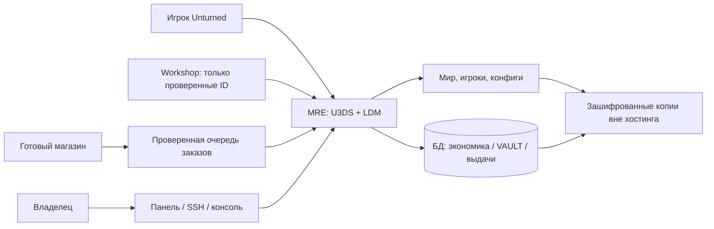

# MRE: технический план запуска и эксплуатации

Дата исследования: **28 октября 2026 года**. Целевой режим после уточнения владельца: **REDLINE #1 PEI — выживание, MAX4, профиль Easy без общего ускорения ×2**. Название REDLINE «1X» — обозначение режима, а не доказанный единый технический коэффициент всех параметров. Начальная ёмкость MRE — 24 игрока; 48 рассматривается после проверки нагрузки. Это проектная архитектура; фактическая локальная установка и выполненные серверные проверки на 30.10.2026 вынесены в LOCAL_INSTALLATION.md. Публичные, игровые и платежные сценарии приняты лишь в явно отмеченном объеме.

## 1. Решение для минимального денежного бюджета

Обновление 30.10.2026: локальная основа установлена и проверена на сервере; текущий Teleportation — MIT-форк MRE 1.8.3.2. Результаты и непроверенные сценарии — в [отчете установки](LOCAL_INSTALLATION.md). Первоначальные формулировки о будущей установке относятся к проектному этапу 28.10.

Один публичный сервер, стандартная PEI, Linux на хостинге, поддерживаемая SDG версия Rocket — **Legally Distinct Missile (LDM)**, минимум плагинов. Windows используется для локальной проверки, если домашний компьютер уже есть. Не покупать карту, панель управления, выделенный сервер, собственный сайт и большие сборки оружия до проверки интереса игроков.

Игровая часть первого запуска: PEI, PvP, профиль Easy с явно зафиксированными изменениями, максимум четыре участника группы, HOME и TPA. Хранилище VAULT входит в MRE 1.0 после испытаний сохранения и защиты от дублирования. Денежная экономика и наборы необязательны и отложены до подтвержденной необходимости. Открытая бета без VAULT допустима только с прямым указанием этого ограничения в описании и запретом продаж VAULT/увеличения его объёма; называть её полным аналогом REDLINE рано.

Донат первой стабильной версии — временные группы привилегий, которые можно проверить и восстановить по журналу. Платные предметы и валюта рассматриваются отдельно после безопасной выдачи и оценки баланса. Продажа только подписок всё равно требует работающего снятия прав по окончании срока: обычное добавление в Rocket-группу этого не доказывает.

LDM включён в поставку U3DS: модуль копируется из `Extras/Rocket.Unturned` в `Modules`. SDG поддерживает этот форк и рекомендует его вместо устаревшей оригинальной версии. Лицензия репозитория — MIT. [Официальная установка Rocket](https://docs.smartlydressedgames.com/en/stable/servers/rocket.html), [исходники LDM](https://github.com/SmartlyDressedGames/Legally-Distinct-Missile).



Готовый магазин и его штатный плагин предпочтительнее собственного платёжного сайта. Возможность надёжной очереди, возвратов и снятия групп у конкретного поставщика проверяется отдельно; схема выше — требование к решению, а не утверждение о возможностях GameStores.

## 2. Что подтверждено по платформе

| Вопрос | Проверенные сведения и практическое решение |
|---|---|
| Серверная программа | Отдельное приложение Unturned Dedicated Server, сокращённо U3DS. Установка не требует покупки игрового хостинга у определённого поставщика. [SDG](https://docs.smartlydressedgames.com/en/stable/servers/server-hosting.html) |
| ОС и установка | Поддерживаются Windows и Linux. SteamCMD загружает U3DS через `app_update 1110390`; вход — anonymous. [SDG: SteamCMD](https://docs.smartlydressedgames.com/en/stable/servers/steamcmd.html) |
| Публичный список | Создать GSLT для **игры 304930**, а не приложения dedicated server 1110390. Указать его через `GSLT` при старте либо `Browser.Login_Token` в конфигурации. Без GSLT сервер скрыт из списка Internet. [SDG: GSLT](https://docs.smartlydressedgames.com/en/stable/servers/game-server-login-tokens.html) |
| Прямое соединение | Два последовательных **UDP**-порта: выбранный `Port` для запросов списка и следующий для игрового трафика. Для `Port 27015` — UDP 27015 и 27016. Устаревшее требование открывать три порта не переносить автоматически. [SDG: порты](https://docs.smartlydressedgames.com/en/stable/servers/port-forwarding.html) |
| Альтернатива публичному IP | Steam Fake IP позволяет подключаться без проброса портов; для публичного списка всё равно нужен GSLT. Включается `Use_FakeIP`; адрес меняется при перезапуске, штатные Steam Favorites/History имеют ограничения. Это вариант для домашней беты, не замена проверки удобства подключения. [SDG: Fake IP](https://docs.smartlydressedgames.com/en/stable/servers/fake-ip.html) |
| Основные конфиги | `Servers/MRE/Server/Commands.dat` — базовые команды. Для новых экземпляров используется **`Servers/MRE/Config.txt`**. Старый `Config.json` не брать за основу нового проекта. [SDG: конфигурация](https://docs.smartlydressedgames.com/en/stable/servers/server-configuration.html) |
| Workshop | ID добавляются в `File_IDs` файла `WorkshopDownloadConfig.json`. Сервер загружает их с зависимостями; клиент получает необходимые файлы при подключении. Для стандартной PEI Workshop-карта не нужна. [SDG: начало работы](https://docs.smartlydressedgames.com/en/stable/servers/server-hosting.html) |
| OpenMod | Есть отдельный модуль и собственная установка; способен работать рядом с Rocket. На первом MRE не устанавливать второй фреймворк без необходимого плагина: это дополнительная поверхность совместимости. [Установка OpenMod](https://openmod.github.io/openmod-docs/userdoc/installation/unturned.html), [репозиторий](https://github.com/openmod/openmod) |

Не помещать настоящий GSLT, пароли БД и ключ магазина в публичный Git. В репозитории остаются примеры; секреты задаются на хостинге и включаются только в зашифрованную резервную копию.

## 3. Матрица функций и бесплатных кандидатов

**Все перечисленные плагины — кандидаты, а не готовая проверенная сборка.** Публичный исходный код и заявленная функция не доказывают совместимость с установленной в день запуска версией игры. Перед фиксацией сборки записать commit/tag, источник DLL, SHA-256, зависимости, лицензию и результат испытаний. Лицензии разных форков одного названия могут отличаться.

| Функция | Конкретный вариант | Лицензия и зависимости | Решение для MRE и риск |
|---|---|---|---|
| Права и группы | [LDM / Rocket](https://github.com/SmartlyDressedGames/Legally-Distinct-Missile) | MIT; входит в U3DS | Базовые группы `default`, `supporter`, `vip`, `moderator`, `admin`. Срок действия покупки — отдельная логика магазина/выдачи, его нельзя считать свойством любой Rocket-группы. |
| TPA | [RestoreMonarchyPlugins/Teleportation](https://github.com/RestoreMonarchyPlugins/Teleportation) | MIT; Rocket/LDM | Есть запросы телепортации, задержка, cooldown, ограничения при combat/raid. Отдельно испытать получателя запроса и обход через алиасы. |
| HOME | [RestoreMonarchyPlugins/MoreHomes](https://github.com/RestoreMonarchyPlugins/MoreHomes) | MIT; Rocket/LDM; интеграция с Teleportation для combat/raid | Домами служат заявленные кровати; есть лимиты, задержки, отмена при движении. Это не произвольные точки `/sethome` из другой игры. |
| Бесплатные наборы | [RocketModPlugins/Kits](https://github.com/RocketModPlugins/Kits) | MIT; Rocket/LDM; Uconomy опционален | Старый код — только основа для проверки/доработки. Cooldown хранится в статических словарях; долговечность между рестартами не обещать. До исправления не использовать для платных наборов или ценных ресурсов. |
| Наборы с постоянными cooldown | [RestoreMonarchyPlugins/Kits](https://github.com/RestoreMonarchyPlugins/Kits) | В открытой корневой выдаче репозитория **не найдена LICENSE**; условия использования необходимо установить | README заявляет сохранение cooldown и ограниченные получения. Не считать автоматически MIT из-за названия или соседних проектов. Вариант: выяснить разрешение у автора либо исправить MIT-кандидат самостоятельно. |
| VAULT | [RocketModPlugins/ItemVault](https://github.com/RocketModPlugins/ItemVault) | MIT; Rocket/LDM, MySQL-клиент/БД по исходникам | Устаревший кандидат с высоким риском потери/дублирования вещей. Для публичного запуска нужен тест аварийного завершения, метаданных и блокировок. До прохождения — выключен; не продавать увеличение VAULT. |
| Экономика | [RestoreMonarchyPlugins/Uconomy](https://github.com/RestoreMonarchyPlugins/Uconomy) | LICENSE содержит GPL v2; Rocket/LDM, БД согласно выбранной сборке | Кандидат на согласованный стек с другими плагинами того же API. Проверить версию драйвера и поддержку используемого сервера БД. Ноль лицензионной цены не означает ноль работы. |
| Другая ветка экономики | [RocketModPlugins/Uconomy](https://github.com/RocketModPlugins/Uconomy) | MIT по корневой лицензии | Другая кодовая ветка. Не подменять её автоматически вместо зависимости старого плагина: имя Uconomy не гарантирует одинаковые классы и методы. |
| Магазин за игровую валюту | [RocketModPlugins/ZaupShop](https://github.com/RocketModPlugins/ZaupShop) | MIT; Uconomy и MySQL по README | Дешёвый кандидат с командами магазина. Требуется совместимый API экономики; сборку и покупки проверять вместе. Начать с малого каталога, без покупки рейдового набора целиком. |
| Обновлённый магазин | [RestoreMonarchyPlugins/ZaupShop](https://github.com/RestoreMonarchyPlugins/ZaupShop) | Корневой LICENSE содержит старый смешанный текст про Rocket/CC/GPL; не помечать его просто MIT | README описывает асинхронную БД. Условия выбранной версии сначала прояснить; запасной путь — подходящий MIT-форк или собственная небольшая адаптация. |
| Combat/raid block | Teleportation + интеграция MoreHomes | Встроены в эти два кандидата, MIT | Защищают соответствующие телепорты. **Не подтверждают** блокирование `/vault`, `/kit`, торговых команд и выдач. Для них нужен общий проверенный guard или запрет команд в бою отдельной доработкой. |
| MAX4 | Штатная настройка лимита группы, проверенная в сгенерированном конфиге | Без отдельного плагина | Найти `Max_Group_Members` и установить 4 в правильной секции текущего `Config.txt`, затем проверить пятый инвайт, lobby и Steam-группы. Межгрупповые союзы решаются правилами и модерацией, а не только числом участников. [Описание групп](https://unturned.wiki.gg/wiki/Groups) |
| Автосохранение | Команда `Save` по расписанию панели/службы; при необходимости небольшой проверяемый scheduler | Зависит от выбранного механизма | Проверить фактическое выполнение раз в 5 минут. Не полагаться на название тарифа или слова «автобэкап». |

Проверка исходников старого Kits: [хранение cooldown в `Kits.cs`](https://github.com/RocketModPlugins/Kits/blob/master/Kits.cs), [выдача в `CommandKit.cs`](https://raw.githubusercontent.com/RocketModPlugins/Kits/master/CommandKit.cs). У VAULT подтверждается работа с MySQL по [Database.cs](https://raw.githubusercontent.com/RocketModPlugins/ItemVault/master/Database.cs). Это основание для оценки риска, а не аудит безопасности всего репозитория.

### Порядок выбора без покупки случайных плагинов

1. Установить LDM, Teleportation и MoreHomes; убедиться, что HOME/TPA закрыты в combat/raid.
2. Если позже понадобятся наборы и денежная экономика, выбрать **один** комплект версий Kits, Uconomy и Shop. Выписать ожидаемые имена сборок/API. До этого эти плагины не устанавливать. Не ставить два плагина, одновременно регистрирующих `/kit`, `/home` или `/tpa`.
3. На проблему совместимости/лицензии выделить один рабочий день. Если бесплатный вариант требует большой переделки, сравнить стоимость готовой лицензии с временем ремонта. При нулевом денежном бюджете перенести функцию, а не скачивать «слив» неизвестной DLL.
4. Исправление MIT-плагина включает тест и фиксацию исходников/лицензии. Оно не становится автоматически готовым из-за генерации кода агентом.
5. VAULT вводить последним, отдельно от магазина и изменения экономики. Так проще найти источник потерь.
6. Общий combat/raid guard должен проверяться на каждом пути изменения состояния: команды, алиасы, интерфейс, повторный запрос, выдача из магазина. Запретить платное обходное право, если весь смысл защиты — сохранение PvP.

### Workshop-моды

Универсальный список «как REDLINE» без его настоящих Workshop ID не составлять. Сначала чистая PEI, затем только подтверждённые нужные моды: название, автор, ID, размер загрузки, зависимости, право использования, какие товары/функции его требуют, дата проверки.

В `templates/WorkshopDownloadConfig.json.example` оставлен пустой список `File_IDs`. Это минимальный пример структуры для слияния с созданным сервером файлом, а не инструкция удалить остальные сгенерированные параметры. В первой версии без подтверждённых модов список остаётся пустым. Шаблон `Commands.dat.example` также не включает готовые MAX4, автосохранение или плагины: эти функции настраиваются и проверяются отдельно.

Большие пакеты оружия, транспорта и строительных блоков увеличивают тестовую матрицу. В первой версии они не нужны для HOME/TPA/наборов. UI-пакет добавлять только с выбранным плагином и его документированным ID. Каждый мод проверять с чистого клиента: быстрый вход владельца с уже скачанным Workshop не показывает опыт новичка.

### Если бесплатной готовой функции нет

Следующие сроки — предварительная оценка собственной разработки для согласования объёма, а не выполненная работа или коммерческая оферта. Они включают ручные испытания, но могут вырасти после проверки API игры и плагина магазина. При самостоятельной работе денежная цена кода может быть нулевой, однако затраченные часы сохраняются; при найме стоимость рассчитывается как согласованные часы × ставка исполнителя.

| Недостающая функция | Оценка работ | Граница объёма |
|---|---|---|
| Постоянный cooldown для MIT Kits | 4–8 ч реализация + 4–8 ч проверка | Сохранение времени, рестарт, обновление без сброса, полный инвентарь |
| Expiry и восстановление платных групп | 8–16 ч реализация + 4–8 ч проверка | UTC, offline, повтор заказа, продление, возврат, несколько активных покупок; без нового платёжного сайта |
| Общий combat/raid guard | 8–16 ч реализация + 4–8 ч проверка | HOME/TPA/VAULT/KIT/SHOP и реальные алиасы выбранного стека |
| VAULT, требующий ремонта старого кандидата | 16–32 ч расследование/изменения + 8–16 ч испытания | Итог может быть отказом от старого плагина; цена не гарантирует исправление любой проблемы |
| Собственный VAULT при отсутствии подходящей основы | 32–64 ч реализация + 16–32 ч испытания | Сериализация состояний предметов, аварийное сохранение, восстановление, ограничения доступа, миграции |
| Надёжная выдача валюты/предметов, которой нет у магазина | 16–32 ч интеграция + 8–16 ч испытания | Только при документированном протоколе и возможности безопасного подтверждения; иначе товары остаются выключенными |

Не складывать эти функции в обязательный первый спринт без ревизии бюджета и времени. Бюджетный запасной путь: бета с HOME/TPA/MAX4 без VAULT и без продаж неподдерживаемых привилегий; к платному запуску перейти после исправления expiry и журнала заказов. Если срок подписки технически не обеспечен, платные подписки тоже не включать. Собственный VAULT отложить за первые доказанные результаты удержания игроков; перед заказом разработки сравнить готовую лицензию и её поддержку.

## 4. Ресурсы и параметры игры

Начальная инженерная оценка для измерения, **не обещание производительности**: 2–4 доступных быстрых потока CPU, 4–8 ГБ RAM, SSD/NVMe с запасом на мир, логи, обновления и копии. Точный объём определяется выбранными модами, постройками, версией игры и соседями по хостингу. БД на том же маленьком VPS конкурирует за память; тариф с «4 vCPU» не гарантирует быстрый игровой поток.

Для минимальной покупки сравнивать две реальные коммерческие конфигурации: игровой хостинг с доступом к DLL/конфигам/БД и небольшой Linux VPS. Если игровой хостинг даёт подходящую RAM и защиту дешевле VPS, выбирать его; за установку собственной панели только ради одного мира не платить.

| Параметр | Исходное решение MRE | Как проверить |
|---|---|---|
| Карта и режим | PEI, PvP, **Easy** как исходный профиль | Вход, урон между разными группами, ночь/день, зомби; убедиться, что загружен Easy |
| Лут | Без общего ускорения ×2; отдельно зафиксировать шанс появления, количество и частоту | REDLINE «1X» не равен гарантированным ванильным значениям. В [аудите REDLINE](REDLINE_AUDIT.md) отдельно разобраны публичный `Spawn_Chance 0.5` и отображение мониторингом ×1.43; окончательные изменения MRE сверить с ним |
| Группа | MAX4 | 5-й участник не проходит; отдельно lobby и статические группы |
| Слоты | 24 на бете и первом публичном запуске | Нагрузочный тест реальными игроками; рост до 32/48 по показателям |
| HOME | 1 кровать обычному игроку; требование MRE: delay **15 с**, cooldown **300 с** | Применённые параметры и права действительно дают это поведение |
| TPA | Требование MRE: delay 15 с, cooldown 300 с | Принимающий и отправляющий не обходят combat/raid и движение |
| Combat block | Требование MRE: **60 с** | Таймер обоим участникам; повторный урон обновляет ограничение |
| Raid block | Требование MRE: **180 с** | Попадание в чужую постройку/взрыв; радиус и стороны события проверены |
| Стартовый kit | Отложен; при необходимости только дешёвые предметы выживания | До включения cooldown переживает рестарт, свободное место проверяется |
| Рестарт | Одно понятное окно обслуживания, исходно 06:00 МСК | Предупреждения, `Save`, `Shutdown`, автоматическое поднятие |
| Сохранение | `Save` каждые 5 минут | Есть запись и проверка сохранённых объектов после аварийного теста |

Числа HOME/TPA/combat/raid — **проектные требования/гипотезы MRE**, а не снятые настройки REDLINE и не гарантия возможностей текущего плагина. Проверить единицы измерения в конфиге конкретного релиза и необходимость доработки. Изменения шанса спавна, количества и частоты лута описывать отдельно; не выдавать маркетинговое «1X» за подтверждение всех ванильных коэффициентов.

## 5. Runbook: от чистой машины до первой закрытой беты

### 5.1. Локальная проверка без аренды

1. На имеющемся Windows ПК установить U3DS через Steam Tools либо SteamCMD. Сам клиент Unturned нужен для входа игроком, серверная программа отдельная.
2. Создать экземпляр с именем `MRE-TEST`. Не смешивать тестовый мир с будущим `MRE`.
3. Один раз запустить, дождаться загрузки и в серверной консоли выполнить `Shutdown`.
4. Скопировать сгенерированные конфиги в рабочую папку без секретов. Записать версию U3DS и пути, которые реально создала программа.
5. Внести имя, PEI, профиль Easy, 24 слота, перспективу; на закрытую бету поставить пароль. Проверить чистую игру до добавления плагинов. Пример использует `Mode Easy` из списка команд; после запуска проверить реально выбранную сложность. В документации SDG встречается название `Difficulty`, поэтому при смене версии ориентироваться также на `Help` и журнал сервера.
6. Поставить LDM, затем Teleportation и MoreHomes по одному. После каждого плагина читать журнал, проверять команды обычным аккаунтом и сохранять рабочую точку.
7. VAULT проверять отдельно. Kits/Shop/экономику на первом запуске не добавлять; возвращаться к ним только по отдельному решению о расширении. Если упал запуск — откатить последнее добавление, не переустанавливать весь мир.

### 5.2. Аренда и установка Linux

1. До оплаты получить подтверждение: можно загружать собственные DLL, доступна консоль и SFTP/SSH, есть подходящая БД, UDP-соединения, экспорт всех сохранений, защита и возможность расширения. Узнать, не удаляется ли мир после истечения тарифа автоматически.
2. Выделить отдельную учётную запись для игры; не запускать U3DS от root. Использовать SSH-ключи и отдельный доступ владельца. Для готового игрового хостинга этот шаг соответствует разграничению ролей панели.
3. Установить SteamCMD по [инструкции Valve](https://developer.valvesoftware.com/wiki/SteamCMD). Пакеты зависимостей брать из актуальной инструкции выбранного Linux, не копировать старую последовательность `apt` вслепую.
4. Запустить SteamCMD и выполнить:

   ```text
   login anonymous
   app_update 1110390 validate
   quit
   ```

5. В каталоге установленного U3DS выполнить:

   ```sh
   ./ServerHelper.sh +InternetServer/MRE
   ```

6. После первой загрузки выполнить в консоли `Shutdown`. На Windows эквивалент запуска из каталога U3DS — `ServerHelper.bat +InternetServer/MRE`.
7. Внести конфиги, применить известный рабочий набор плагинов, права и переводы с локального теста. Сгенерировать GSLT вручную на [странице Steam](https://steamcommunity.com/dev/managegameservers) для app 304930 и добавить его в приватную конфигурацию.
8. Настроить выбранный сетевой путь. Для прямого IP разрешить UDP 27015–27016 в firewall хостинга и ОС; SSH ограничить. Не открывать БД и удалённую административную консоль всем IP. При Fake IP проверить ограничения и устойчивый способ найти сервер после рестарта.
9. Подключиться с внешней сети, проверить список Internet, имя, карту, пароль, VAC/BattlEye и журнал загрузки. Обычный UDP-скан не заменяет настоящий вход клиента.
10. Настроить запуск после перезагрузки хоста и контролируемое восстановление после падения. Панель/служба должна уметь передать игре `Shutdown`, дождаться окончания и только потом обновлять/останавливать процесс. Без этого `systemctl stop` сам по себе не доказывает сохранение мира.
11. Настроить реальное расписание `Save` и копий; выполнить восстановление на тестовом экземпляре.
12. Включать магазин и брать деньги после проверки выдачи и сроков, описанной ниже.

Команды установки, запуска и файлы экземпляров сверены с [официальной инструкцией SteamCMD](https://docs.smartlydressedgames.com/en/stable/servers/steamcmd.html). В текущей папке проекта они не выполнялись.

### 5.3. Фиксация сборки

В будущий `release-manifest.csv` занести: `component`, `version_or_commit`, `source_url`, `sha256`, `license`, `dependencies`, `tested_game_build`, `tested_at`, `result`. Оставить сам оригинальный архив и LICENSE. Для Workshop фиксировать ID и время обновления, поскольку содержимое может поменяться без изменения ID.

В каждом релизе хранить изменения баланса, каталога и разрешений. Не обновлять все DLL и Workshop-пакеты одновременно «потому что вышла версия».

## 6. Выдача доната и сохранение прав

### 6.1. Что хранить

Минимальная запись заказа: поставщик, уникальный ID заказа/строки, SteamID64, код товара, количество, сумма/валюта, статус оплаты, время подтверждения, статус выдачи, попытки, последний результат и ссылка на подтверждение поставщика. Для подписки — абсолютное время начала/окончания UTC и группа. Для сезонных товаров — `season_id`/`wipe_id`.

Веб-баланс магазина в рублях и игровая валюта — разные сущности. Пополнение баланса сайта не означает, что игроку уже начислили игровые деньги. Привязка Steam должна подтверждать SteamID64; ник игрока не идентификатор покупки.

### 6.2. Предпочтительный дешёвый путь

1. У готовой платформы магазина выбрать штатный поддерживаемый плагин Unturned и тестовый режим/минимальную операцию, если она предусмотрена.
2. Проверить, как платформа идентифицирует подтверждённую оплату, очередь офлайн-игрока, повторные callbacks, дату окончания и отзыв группы.
3. Если одно из требований не поддерживается, отключить соответствующий вид товаров. Например, сначала продавать срок группы с проверяемым исполнением, а не валюту через слепую повторяющуюся консольную команду.
4. Малый объём заказов допускает ручную обработку только с журналом, подтверждением из кабинета поставщика и ясным сроком выдачи. Скриншот перевода не подтверждает оплату. Ручная выдача не должна обещаться мгновенной.
5. Собственный мост писать только при конкретной недостающей функции и понятном протоколе поставщика. Не проектировать «универсальный webhook» с выдуманной подписью или API.

### 6.3. Надёжность: требования к готовому плагину или собственному мосту

- Принимать состояние «оплачено» из проверенного серверного API/подписанного сообщения поставщика. Сверять товар, сумму, валюту и принадлежность магазину; ссылка возврата пользователя из браузера не подтверждение.
- Уникальный ключ обработки: `(provider, order_id, line_id)`. Повторные сообщения не создают новую выдачу.
- Статусы: `awaiting_payment → paid → pending_delivery → delivered`; отдельно `failed`, `manual_review`, `refunded`. Актуальное соответствие статусам конкретной платформы документируется при интеграции.
- Для группы использовать операцию «обеспечить право до заданной даты», а не «продлить ещё на 30 дней» при каждом повторе. Повтор одного заказа не двигает срок. Правило продления: `max(now, current_expiry) + duration` вычислять и сохранять **один раз на новый заказ**.
- Снятие доступа проверяется периодически и при входе игрока, включая запуск после простоя. Нельзя зависеть только от таймера в RAM.
- Несколько действующих покупок одной группы учитываются вместе: истечение старого заказа не снимает новую подписку. Возврат отзывает только права возвращённого заказа с пересчётом остальных.
- Для валюты изменение баланса и запись обработанного заказа должны быть в одной транзакции соответствующей БД либо обеспечиваться подтверждённой идемпотентностью получателя. Запись `delivered` в одной базе после выполнения команды в другом процессе не решает окно «начислили, но не записали».
- Для предметов нет основания обещать «ровно один раз» через обычную удалённую консоль: сервер может упасть между выдачей и ACK. Нужна сохраняемая очередь и протокол подтверждения/восстановления, либо передача спорного заказа в ручную проверку без слепого повтора.
- Полный инвентарь, отсутствие игрока, несуществующий ID предмета и временная ошибка БД не считаются успешной выдачей. Не выбрасывать платные вещи на землю автоматически.
- Ключ магазина не должен давать произвольное выполнение команд из пользовательского текста. Разрешить только заранее заданный каталог и конкретные действия; SteamID/количества валидировать.
- При недоступности магазина/БД сервер остаётся игровым, а неподтверждённая покупка ждёт восстановления. Не компенсировать потерянный ответ вторым начислением.

### 6.4. Вайп и срок покупок

Длительность привилегии в днях и действие набора «на вайп» — разные товары. До продажи каждого товара указать: когда начинается срок, переживает ли вайп, обнуляется ли валюта, что происходит с VAULT, сколько раз доступен набор, при каких условиях возможна повторная выдача.

Подписки и оплаченные заказы хранить отдельно от удаляемых сохранений мира. При вайпе не удалять платёжный журнал. Обнуление мира не должно автоматически запускать повторную выдачу всех прежних заказов. Купленные вещи/валюта после восстановления старого бэкапа требуют сверки с журналом заказов и действий, выполненных после времени копии.

Правила SDG запрещают серверу продавать доступ к ванильному премиум-контенту, включая преимущества Gold Upgrade и ванильные косметические предметы/скины. Собственный косметический контент требует прав на него. Проверять каталог MRE по [Server Hosting Rules](https://docs.smartlydressedgames.com/en/stable/servers/server-hosting-rules.html); наличие товара у другого сервера не является разрешением.

## 7. Права доступа и защита игрового баланса

Точные permission nodes брать из документации **выбранной версии**, не переносить универсальный пример из другого плагина. У старого Kits и нового Kits различаются, например, права вызова команды; слепое копирование XML даст ошибки или лишний доступ.

| Роль | Назначение | Проверка |
|---|---|---|
| default | HOME/TPA/разрешённые наборы/информация | Нет создания наборов, изменения баланса, выдачи предметов себе или другим |
| supporter / vip | Только явно описанные преимущества | Нет `*`, admin, bypass combat/raid, бесконечной выдачи наборов |
| moderator | Жалобы, чат, оговорённые kick/ban-полномочия | Нет магазина, изменения доната, доступа к файлам/секретам; действия логируются |
| admin | Ограниченный круг доверенных администраторов | Владелец видит действия; игровой аккаунт администратора отделён от обычной игры по правилам проекта |
| owner | Аккаунт владельца сервера | Steam Guard, отдельные ключи и восстановление доступа |

Безопасная начальная монетизация не требует сильнейшего оружия за деньги. Из дополнительных HOME/VAULT и времени ожидания выбрать те преимущества, которые прошли испытания и не уничтожают ценность обычного выживания. Продажа админки, отключения античита и иммунитета к правилам не требуется для модели MRE.

VAC/BattlEye держать включёнными и проверять их состояние в журнале; это не снимает необходимость жалоб, доказательств и апелляций. Не включать автоматический бан только за высокий K/D или статистическую догадку.

## 8. Резервное копирование, восстановление и обновления

### 8.1. Цели

Предложение для малого старта: потеря после обычного падения — не более **5 минут игрового мира** при работающем `Save`; потеря при полной утрате хостинга — не более **24 часов** при ежедневной внешней копии; восстановление исправной копии — до **60 минут** после получения нового доступного экземпляра. Это разные аварии, а не одна гарантия. Копирование БД и изменение журнала выдач может потребовать более частой выгрузки.

Игровой мир не имеет гарантированного встроенного автосохранения только от самого факта запуска: SDG описывает `Save` и корректный `Shutdown`. [Официальное сохранение и остановка](https://docs.smartlydressedgames.com/en/stable/servers/server-hosting.html).

### 8.2. Ежедневная согласованная копия

1. Предупредить игроков; приостановить очередь выдачи и зафиксировать её состояние.
2. Выполнить `Save`, затем `Shutdown`; дождаться завершения игры. Для маленького проекта короткое объявленное окно проще и надёжнее сложного горячего снимка.
3. Скопировать **весь экземпляр `Servers/MRE`**, игровые конфиги, Rocket-конфиги/права и plugin data, а также манифест с версиями и архивы собственных DLL. Глобальный `Modules` и настройки службы сохранить отдельно.
4. Пока игровой процесс остановлен, сделать логическую выгрузку всех используемых БД. Имена таблиц определить у реальных установленных плагинов. Для MySQL/MariaDB проверить способ дампа и возможность его импорта: не считать эти движки автоматически взаимозаменяемыми для любого драйвера.
5. Сохранить журнал заказов и выдач, если он отдельный; его внешний источник не удалять при очистке игрового мира.
6. Упаковать, зашифровать, посчитать контрольную сумму, отправить на другой носитель/аккаунт. Домашний диск владельца подходит для бюджетного старта, если получение автоматизировано и проверяется. Копия на том же VPS защищает только от части ошибок.
7. Запустить сервер; проверить вход, актуальный мир и БД. Возобновить очередь после проверки.
8. Хранить исходно 7 ежедневных и 4 еженедельных копии, если хватает места. Сначала убедиться, что новая копия рабочая, и только потом удалять старую по расписанию.

`tar`/ZIP живого мира плюс независимый дамп живой БД не объявлять согласованной копией без дополнительного механизма. Файлы мира, инвентари, VAULT и баланс должны относиться к совместимой точке времени.

### 8.3. Проверка восстановления

1. Поднять `MRE-RESTORE` с другим портом и паролем, закрытым от публичных игроков. Очередь магазина и исходящие выдачи отключены, производственный GSLT одновременно не используется.
2. Восстановить файлы и БД одной копии; установить соответствующие версии модулей/плагинов.
3. Проверить постройку, кровать, инвентарь, VAULT, баланс, cooldown, права и срок подписки двух тестовых аккаунтов.
4. Проверить, что заказы, ранее отмеченные исполненными, не выдаются заново. Установить порядок сверки заказов после времени копии.
5. Замерить время, записать результат. Первое восстановление обязательно до запуска доната; повтор — после изменения схемы данных/VAULT/механизма покупок и минимум ежемесячно.

### 8.4. Обновление

1. Сначала релизные заметки игры/плагина и тестовая копия с актуальным миром. Если клиент игры получил обязательное обновление, ускорить техническое окно, сохраняя последовательность остановки и копии.
2. Приостановить выдачи, предупредить игроков, `Save`, `Shutdown`, согласованная копия.
3. Обновить U3DS через `app_update 1110390`; нужные DLL и Workshop обновлять осознанно. LDM брать из поставки соответствующего U3DS, если это требуется обновлением.
4. Запустить под паролем; проверить загрузку, консоль, соединение, HOME/TPA, сохранение, БД и права.
5. Открыть доступ и возобновить выдачи после проверки. Сохранить версию и результат.
6. При провале вернуть совместимую конфигурацию/плагины и копию мира. Если клиенты уже обновились и старый сервер недоступен им по версии, откат сервера не гарантирует возвращения игры: временно отключить несовместимый плагин, держать выдачи на паузе и объявить окно обслуживания.

## 9. Испытания и критерии завершения

Проверка нужна обычными аккаунтами. У администратора часто есть bypass ограничений, который маскирует ошибку прав.

| ID | Сценарий | Условие приёмки |
|---|---|---|
| T01 | Новый клиент из внешней сети | Находит MRE, скачивает только нужные моды, входит без ошибок отсутствующих assets |
| T02 | Группа из четырёх, приглашение пятого, lobby/Steam-группа | Настоящий лимит 4; обходы перечислены и закрыты/урегулированы |
| T03 | HOME: движение, урон, уничтоженная кровать, выход/вход | Нет ухода из боя и телепортации под карту; потерянная кровать не остаётся вечной точкой |
| T04 | TPA в обе стороны, запрос до боя и принятие во время боя | Ограничение действует при фактическом переносе, включая алиасы |
| T05 | kit: повтор, рестарт, другой аккаунт, заполненный инвентарь | Ограничения не сбрасываются неожиданно; нет лишней выдачи/списания |
| T06 | VAULT: обычный перенос, метаданные оружия/рюкзака/заряда, disconnect | Количество и состояние вещей сохраняются |
| T07 | VAULT: аварийное завершение в момент открытия/переноса/закрытия | Нет подтверждённого дублирования или исчезновения; при неисправности VAULT не допускается в релиз |
| T08 | Экономика: покупка/продажа, ноль средств, отрицательная сумма, ошибка БД | Нельзя получить бесплатный предмет или отрицательный баланс; неоднозначная операция разбирается |
| T09 | Донат: подтверждённый заказ, офлайн-игрок, повтор 3–10 раз | Единственное право/начисление; проверяемое состояние в журнале |
| T10 | Донат: сервер упал до/после выдачи, потерян ACK | Нет слепой двойной выдачи; неоднозначный заказ переходит на сверку |
| T11 | Подписка истекла при работающем сервере, при его простое и после продления | Доступ снят или сохранён строго по актуальным заказам; UTC/МСК отображаются корректно |
| T12 | Вайп и возврат копии | Мир сбрасывается по политике; заказы/подписки не теряются и не повторяются |
| T13 | Вход default/vip/moderator | Никто из них не получает админку, wildcard, создание товаров или изменение баланса |
| T14 | Нагрузка с постройками, PvP, телепортами и сохранением | Измерены задержки, RAM и самый загруженный поток, отсутствуют OOM/зависания/ошибки БД |
| T15 | Restore на новом экземпляре | Восстановление всех связанных данных проходит в целевое время |
| T16 | Недоступность БД/магазина/Workshop и перезагрузка хоста | Понятное состояние и журнал; игра/очередь восстанавливаются по runbook |

Для T07 намеренное аварийное завершение разрешено только на отдельном тестовом мире с тестовыми вещами. Тесты не выполнялись в рамках подготовки плана.

### Ёмкость и рост

- Проверить минимум 2 часа при 12–24 реальных участниках, включая бой, стройку, VAULT и `Save`; затем 24 часа работы беты с журналом ошибок и наблюдением за ростом RAM.
- Предлагаемый запас: RAM стабильно ниже 75–80% доступного лимита и без OOM; главный загруженный поток не упирается длительно в потолок; сохранение не вызывает заметного для игроков регулярного зависания. Порог CPU оценивать на уровне процесса/потока, а не только среднего по четырём vCPU.
- Собирать p50/p95 ping и жалобы на задержки; сравнивать с чистой PEI на том же тарифе. Не обещать универсальные 60 FPS или определённый tickrate без замера именно этой версии.
- Для 32 и 48 слотов повторить тест с таким числом игроков и накопленными постройками. Пустой сервер с `MaxPlayers 48` не является нагрузочным тестом.
- При нехватке ресурса сначала убрать тяжёлую необязательную механику, ограничить скопление построек разумными правилами и проверить соседей по хостингу; затем расширять тариф. Рост слотов без роста устойчивости не нужен.

**Технический финиш:** опубликован точный манифест, доступны обязательные функции выбранной версии, проходят T01–T16 для включённых возможностей, протестировано восстановление, работает журнал доната и снятие подписок, владелец знает процедуру обновления и аварии. Если VAULT или автоматическая выдача не прошли проверку, статус — ограниченная бета, а сроки/описание продаж отражают реальное состояние.

## 10. Первые действия при инциденте

| Симптом | Первые действия | Возврат к работе |
|---|---|---|
| Сервер не виден | Проверить процесс/журнал, GSLT, выбранный сетевой путь, UDP-пару; запросить внешний вход | Когда внешний игрок действительно подключился |
| После обновления падает запуск | Сохранить логи и текущие файлы, определить последний плагин/Workshop, временно отключить его на копии | После входа и проверки сохранений; не терять очередь покупок |
| Появился дюп VAULT/магазина | Закрыть подозрительную функцию и её продажи; сохранить БД и журнал; не объявлять произвольный полный вайп | После воспроизведения, исправления и повторения T06–T10 |
| Заказ оплачен, товар не выдан | Найти order ID и SteamID64, проверить состояние у поставщика и журнал обработки, определить была ли фактическая выдача | Выполнить подтверждённую недостающую операцию один раз; уведомить игрока |
| Данные повреждены | Остановить запись и выдачи, снять копию повреждённого состояния для анализа, выбрать согласованную резервную точку | Восстановление + сверка заказов после времени копии |
| Лаги/память | Снять показатели и ошибки, проверить массовые постройки, БД и последний плагин; объявить окно | После сравнения с базовой нагрузкой и фиксации причины |
| Атака на доступность | Проверить состояние через панель/консоль, обратиться в поддержку оплаченного хостинга; при необходимости тестировать SDR/Fake IP | Когда вход и задержки устойчивы; простое добавление RAM не доказанное средство от атаки |

Журнал инцидента: время МСК/UTC, симптомы, версия сборки, изменения перед сбоем, затронутые игроки/заказы, сохранённые доказательства, действие, результат, как избежать повторения. Это позволяет следующему агенту или администратору продолжить работу по фактам.
